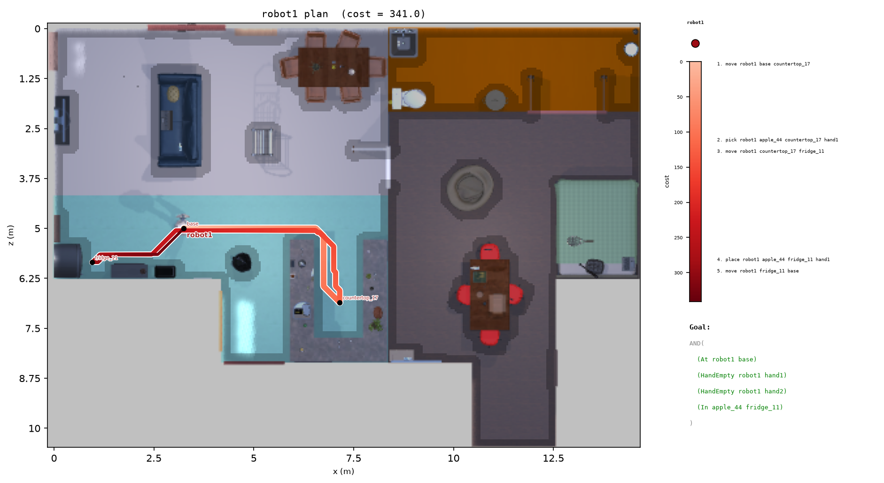

# `scenegraph-pddl` : Task planning in ProcTHOR houses with PDDL and Fast Downward

**ProcTHOR house → scene graph → PDDL problem → Fast Downward plan**

`scenegraph-pddl` is a symbolic task planning pipeline for household robots. It loads a [ProcTHOR-10k](https://procthor.allenai.org/) house in [AI2-THOR](https://ai2thor.allenai.org/), builds a scene graph from it, writes a pick-and-place PDDL problem whose move costs are real walking distances, and solves it with the [Fast Downward](https://www.fast-downward.org) planner.

*Developed by the [Robot Anticipatory Intelligence & Learning (RAIL) Group @ GMU](https://people.cs.gmu.edu/~gjstein/), led by Prof. Gregory J. Stein.*

#### Key properties
- **Scene graphs from ProcTHOR**: any of the 10,000 ProcTHOR-10k houses becomes a graph of apartment → rooms → containers → objects.
- **Real move costs**: moves cost their shortest walking distance over an occupancy grid built from the simulator's reachable positions.
- **Readable goals**: ask for `apple fridge` and the goal becomes `(In apple_44 fridge_11)`.
- **Fast Downward included**: the planner is cloned and built locally the first time it's needed.
- **Learning-ready nodes**: every node carries a sentence-BERT embedding of its name plus a one-hot node type.

#### Example: put an apple in the fridge

In ProcTHOR house 3, the robot starts at `base`, walks to the kitchen countertop for the apple, carries it to the fridge and returns. The route is drawn over the house seen from above, light to dark red by the plan cost spent so far; everywhere the robot cannot stand is darkened. Right: the plan's actions placed by the cost at which each starts, and the goal.



```bash
make pipeline SEED=3 GOALS="--goal apple fridge"
```

```
Scene graph: 46 nodes, 13 containers, 28 objects
Goal: [('apple_44', 'fridge_11')]
Plan (5 steps, cost 341.0):
  move robot1 base countertop_17
  pick robot1 apple_44 countertop_17 hand1
  move robot1 countertop_17 fridge_11
  place robot1 apple_44 fridge_11 hand1
  move robot1 fridge_11 base
```

The cost is 10 (pick) + 10 (place) + 321 for the three moves, measured in 0.05 m grid cells. The run takes about 15 seconds, most of it starting AI2-THOR and embedding node names.

## Quickstart via the [`uv`](https://docs.astral.sh/uv/) package manager

```bash
git clone git@github.com:RAIL-group/scenegraph-pddl.git
cd scenegraph-pddl
uv sync              # Python 3.12 environment and dependencies (~1 min)
make download        # ProcTHOR-10k houses + sentence-BERT model into ./data (~1 min)
make pipeline SEED=3 GOALS="--goal apple fridge"
```

Run every command from the repository root: the code finds `./data` and `./third_party` relative to the working directory.

The first run also builds Fast Downward into `./third_party` (1–3 min; or run `make fast-downward` ahead of time) and downloads the AI2-THOR simulator to `~/.ai2thor` (775 MB). To use an existing Fast Downward checkout, set `FAST_DOWNWARD_DIR=/path/to/downward`.

#### Requirements

| | |
|---|---|
| OS | macOS (tested on Apple Silicon) or Linux |
| Tools | [uv](https://docs.astral.sh/uv/), `git`, [`git-lfs`](https://git-lfs.com) (only for `make download`, to fetch ProcTHOR-10k), `make`, CMake ≥ 3.16, a C++20 compiler |
| Disk | About 5 GB: Python environment 1.1 GB plus 1 GB uv cache, AI2-THOR simulator 1 GB (`~/.ai2thor`), data 750 MB plus 550 MB download caches (`~/.prior`, `~/.cache/huggingface`), Fast Downward 240 MB |

```bash
# macOS
xcode-select --install                # C++ compiler, git, make
brew install cmake uv git-lfs
softwareupdate --install-rosetta      # Apple Silicon only: the AI2-THOR simulator is an Intel build

# Linux (Debian/Ubuntu)
sudo apt-get install build-essential cmake git git-lfs
curl -LsSf https://astral.sh/uv/install.sh | sh
```

*Note:* uv installs Python 3.12 (pinned in `.python-version`) by itself. On Linux, AI2-THOR needs an X display; on a headless machine, prefix commands with `xvfb-run -a`. Only macOS has been tested.

## Running the pipeline

```bash
make pipeline SEED=0                                                 # one random goal
make pipeline SEED=7 GOALS="--goal apple fridge --goal mug sink"     # several goals
make pipeline SEED=7036 PLANNER=ff-wastar2                           # faster planner for big houses
uv run python -m scenegraph_pddl.scripts.run_pipeline --seed 7036 --num-random-goals 3 --planner ff-wastar2
uv run python -m scenegraph_pddl.scripts.run_pipeline --help
```

| Option | Make variable | Default | Meaning |
|---|---|---|---|
| `--seed N` | `SEED` | 0 | ProcTHOR-10k house index (0–9999) |
| `--goal OBJECT CONTAINER` | `GOALS` | random | Put `OBJECT` in `CONTAINER`; repeatable |
| `--num-random-goals N` | | 1 | Number of random goals if no `--goal` is given |
| `--planner P` | `PLANNER` | `ff-astar` | See [Planners](#planners) |
| `--output-dir DIR` | | `data/pipeline` | Where outputs go |

Each run writes to `data/pipeline/seed_<N>/`:

| File | Contents |
|---|---|
| `scene_graph.json` | Nodes (name, type, grid position), edges, container and object indices |
| `scene_graph.png` | Picture of the graph |
| `domain.pddl` | Copy of the domain used |
| `problem.pddl` | Generated problem |
| `plan.txt` | Fast Downward plan, ending with `; cost = ...` |
| `fast_downward.log` | Full planner output |
| `plan.png` | The plan drawn on the house, as in the example above |

#### Planners

| `PLANNER` | Fast Downward search | When to use |
|---|---|---|
| `ff-astar` (default) | A* with the FF heuristic | Small houses; tends to find cheaper plans, but can take minutes on houses with many containers |
| `ff-wastar2` | Lazy weighted A* (w=2) with FF and preferred operators | Larger houses; plans in seconds, possibly more expensive |
| any other string | passed as `--search`, e.g. `"astar(lmcut())"` | Your own configuration. Optimal search is usually too slow at this size |

The names follow pddlstream's planner names.

## Quick Example: Python API

```python
from scenegraph_pddl.pddl import fast_downward, problem
from scenegraph_pddl.scripts.run_pipeline import load_scene

house, graph = load_scene(seed=3)                        # 1. house -> scene graph
motion_costs = problem.compute_motion_costs(house, graph)
pddl = problem.build_problem(graph, [('apple', 'fridge')], motion_costs)
with open('problem.pddl', 'w') as f:                     # 2. scene graph -> problem.pddl
    f.write(pddl)
actions, cost = fast_downward.solve(problem.DOMAIN_PATH, 'problem.pddl',
                                    planner='ff-wastar2')  # 3. problem.pddl -> plan
```

`run_pipeline(seed, goals, ...)` in the same module does all three steps and writes the output files.

## How it works

#### 1. House → scene graph

[`house.py`](./src/scenegraph_pddl/house.py), `ProcTHORHouse(seed)`:
- Reads line `seed` of `data.jsonl` and loads that house into an AI2-THOR `Controller`.
- **Occupancy grid**: asks the simulator for its reachable positions (`GetReachablePositions`, 0.05 m grid). Reachable cells are free (`0`), everything else occupied (`1`). Each container, and the objects inside it, moves to the nearest reachable cell; each room gets the free cell nearest its centre; the robot's start cell is `robot_position`.
- **Preprocessing**: drops containers in `IGNORED_ASSETS` (lamps, paintings, TVs, …) and empty containers, numbers repeated container names, keeps each object name once per house, and keeps at most 7 objects per container.
- Stops the simulator once the grid is built. `house.path_cost(start, goal)` gives the shortest-path length between two cells.

[`scene_graph.py`](./src/scenegraph_pddl/scene_graph.py):
- `build_scene_graph(house)`: nodes for the apartment, rooms, containers and objects, each with an `id`, `name`, `type` and grid `position`. Edges run apartment–room, room–room (through a door), room–container and container–object.
- `add_node_features(graph)`: 768-dimensional sentence-BERT embedding of the name plus a one-hot node type, in `node_features`.
- `save_scene_graph(graph, dir)`: writes `scene_graph.json` and `scene_graph.png`.

#### 2. Scene graph → problem.pddl

[`pddl/problem.py`](./src/scenegraph_pddl/pddl/problem.py):
- **Names**: every node gets a unique PDDL name from its generic name and index, e.g. `fridge_19`.
- **Initial state**: `(Robot robot1)` `(At robot1 base)` with two empty hands `hand1` and `hand2`; `(Object o)` and `(In o c)` for every object; `(ContainerUnsafe base)` so nothing is put down at the start; `(Motion a b)` and `(= (MotionCost a b) d)` for every connected pair of locations.
- **Move costs**: `compute_motion_costs(house, graph)` runs Dijkstra ([`grid.py`](./src/scenegraph_pddl/grid.py)) once from each location. Costs are rounded to integers because Fast Downward only accepts integer costs.
- **Goal**: `(In object container)` for each requested pair, plus the robot back `At base` with both hands empty. Goal names can be PDDL names (`apple_63`) or generic names (`apple`, first match); unknown names raise an error listing the valid ones.

The domain, [`pddl/domain.pddl`](./src/scenegraph_pddl/pddl/domain.pddl):

| Action | Precondition | Cost |
|---|---|---|
| `move ?r ?s1 ?s2` | robot at `?s1`, `(Motion ?s1 ?s2)` | `MotionCost ?s1 ?s2` |
| `pick ?r ?b ?s ?h` | robot at `?s`, `?b` in `?s`, hand `?h` empty | 10 |
| `place ?r ?b ?s ?h` | robot at `?s`, holding `?b` in `?h`, `?s` not `ContainerUnsafe` | 10 |

#### 3. problem.pddl → plan

[`pddl/fast_downward.py`](./src/scenegraph_pddl/pddl/fast_downward.py):
- `ensure_installed()` clones `aibasel/downward` at `release-24.06.1` into `./third_party/fast-downward` and runs its `build.py`, unless it's already built.
- `solve(domain, problem, planner=...)` runs `fast-downward.py` and returns the plan as a list of action tuples plus its total cost, or `(None, None)` if there is no plan.

[`plotting.py`](./src/scenegraph_pddl/plotting.py) draws `plan.png`, following the conventions of [`railroad`](https://github.com/RAIL-group/railroad)'s ProcTHOR plots:
- `house.render_top_down()` renders an orthographic top-down view while the simulator is still running, framed in grid coordinates so it lines up with the occupancy grid.
- `plan_route(house, graph, actions)` replays the plan: each move follows the same shortest path its `MotionCost` was measured on, and pick and place hold the robot still for their cost of 10.
- The route is drawn as a tapering trail with a white outline over the top-down view, with occupied cells darkened rather than drawing the grid itself. The axes are in metres. The sidebar places each action against a cost scale and lists the goal.

## Architecture

```
.
├── Makefile                  install / download / fast-downward / pipeline / test / flake8
├── pyproject.toml            package metadata and dependencies (Python 3.12)
├── src/scenegraph_pddl/
│   ├── config.py             data, model and Fast Downward paths
│   ├── house.py              ProcTHORHouse: load a house, build its occupancy grid
│   ├── grid.py               shortest paths over the occupancy grid
│   ├── scene_graph.py        build, featurise, draw and save the scene graph
│   ├── plotting.py           draw the plan on the house (plan.png)
│   ├── pddl/
│   │   ├── domain.pddl       pick/place/move domain
│   │   ├── problem.py        scene graph -> problem.pddl
│   │   └── fast_downward.py  install Fast Downward and solve
│   └── scripts/
│       ├── download_data.py  ProcTHOR-10k houses + sentence-BERT model
│       └── run_pipeline.py   the three steps for one house
├── tests/
├── assets/                   images for this README
├── data/                     (created) houses, sentence-BERT model, pipeline outputs
└── third_party/              (created) Fast Downward checkout and build
```

## Development

```bash
make test     # pytest
make flake8   # style check
```

- `tests/test_grid.py`: shortest paths on small grids.
- `tests/test_problem.py`: problem generation and solving on a hand-made scene graph; the solve test is skipped until Fast Downward is built.
- `tests/test_plotting.py`: route replay and plotting on a hand-made house.
- `tests/test_pipeline.py`: the full pipeline on ProcTHOR house 0; skipped until `make download` has been run.

## Troubleshooting

- **`FileNotFoundError: ./data/procthor-data/data.jsonl`**: run `make download`, from the repository root.
- **`make download` says `git-lfs is required`** (or Python fails with `No such file or directory: 'wget'`): the ProcTHOR-10k download uses Git LFS. Install it with `brew install git-lfs` or `sudo apt-get install git-lfs`.
- **AI2-THOR hangs or crashes on start (macOS, Apple Silicon)**: install Rosetta 2 with `softwareupdate --install-rosetta`.
- **AI2-THOR fails on Linux with a display error**: run under `xvfb-run -a`, or set `DISPLAY` to a running X server.
- **Fast Downward build fails**: check that `cmake --version` is ≥ 3.16 and a C++20 compiler is installed, then delete `third_party/fast-downward` and rerun `make fast-downward`.
- **The planner runs for minutes**: use `PLANNER=ff-wastar2`.
- **`ValueError: No object named ...`**: that name isn't in this house after preprocessing. The error lists the valid names, and so does `scene_graph.json`.
- **The editor can't find imports**: point it at `.venv/bin/python`.

## Credits

The scene graph and ProcTHOR loading code come from the `procgraph` and `antplan` modules of [RAIL-core](https://github.com/RAIL-group). Planning uses [Fast Downward](https://www.fast-downward.org) (GPL-3.0). See [LICENSE](./LICENSE).
